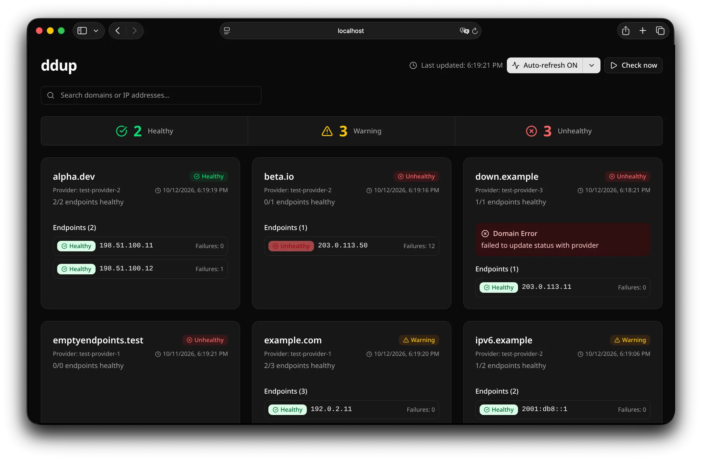

<div align="center">
  
</div>

# ddup - Dynamic DNS Health Checker

ddup periodically checks the health of your services and updates the DNS records pointing to healthy deployments.

You can use ddup to configure [round-robin DNS](https://en.wikipedia.org/wiki/Round-robin_DNS) for load balancing and failover, for internal or external apps, automatically excluding un-healthy replicas.

ddup is **not** a DNS server, instead it works with "dynamic" DNS servers. Currently, it supports these DNS providers:

- AWS Route53
- Azure DNS
- Cloudflare DNS
- Google Cloud DNS
- OVH



## Installation

### Using Docker/Podman

You can run ddup as a Docker/Podman container. Container images are available for Linux and support amd64, arm64, and armv7/armhf.

First, create a folder where you will store the configuration file `config.yaml`, for example `$HOME/.ddup`. You can then start ddup with:

```sh
# For podman, replace "docker run" with "podman run"
docker run \
  -d \
  --read-only \
  -v $HOME/.ddup:/etc/ddup:ro \
  ghcr.io/italypaleale/ddup:v0
```

> ddup follows semver for versioning. The command above uses the latest version in the 0.x branch. We do not publish a container image tagged "latest".

### Using Docker Compose

This is an example of a `docker-compose.yaml` for running ddup:

```yaml
version: "3.6"

services:
  ddup:
    image: "ghcr.io/italypaleale/ddup:v0"
    volumes:
      # Set the path on the host OS
      - "/path/to/ddup:/etc/ddup:ro"
    restart: "unless-stopped"
    read_only: true
    logging:
      driver: "json-file"
      options:
        max-file: "5"
        max-size: "20m"
```

### Start as standalone app

You can download the latest version of ddup from the [Releases](https://github.com/italypaleale/ddup/releases) page. Fetch the correct archive for your system and architecture, then extract the files and copy the `ddup` binary to `/usr/local/bin` or another folder.

Place the configuration for ddup in the `/etc/ddup` folder.

You will need to start ddup as a service using the process manager for your system.

For example, for Linux distributions based on **systemd** you can use the sample unit in [`ddup.service`](./ddup.service): copy this file to `/etc/systemd/system/ddup.service`.

Start the service and enable it at boot with:

```sh
sudo systemctl enable --now ddup
```

## Configuration

ddup requires a configuration file `config.yaml` in one of the following paths:

- The path defined in the `DDUP_CONFIG` env var
- `/etc/ddup/config.yaml`
- `$HOME/.ddup/config.yaml`
- Or in the same folder where the ddup binary is located

You can find an example of the configuration file, and a description of every option, in the [`config.sample.yaml`](/config.sample.yaml) file.

> A config file can reference other files to load secrets from, using `!file /path/to/file` or `!envfile /path/to/.env VAR_NAME`. See [go-kit's README](https://github.com/ItalyPaleAle/go-kit/blob/main/config/README.md) for more details.

## Configuration Options

### Global Settings

- `interval`: How often to perform health checks (e.g., "30s", "1m", "5m")

### Domains and Endpoints

- `domains`: Array of domains to manage
  - `recordName`: The DNS record to update (e.g., "api.example.com")
  - `provider`: Name of the DNS provider (from the [`providers` map](#providers-configuration))
  - `ttl`: Time to live for DNS records. A short value is preferred to ensure faster failover from failed deployments. The default value is 120 (seconds, equivalent to 2 minutes)
  - `healthChecks`: Configuration for health checks
    - `timeout`: Request timeout (default: "3s")
    - `attempts`: Maximum number of consecutive attempts before considering the endpoint unhealthy (default: 2)
    - `recoverAfter`: Consecutive successful checks needed before an endpoint that was removed from DNS is added back (default: 1)
    - `method`: `GET` (default) or `HEAD`
    - `expectStatus`: Status code that means healthy: an exact code (like `204`) or `2xx` for any 2xx code. Default: `2xx`. Redirects are not followed
  - `endpoints`: Array of endpoints for this domain
    - `name`: Friendly name for the endpoint, used for logging (optional)
    - `url`: HTTP URL to check for health status
    - `ip`: The IPv4 or IPv6 address to include in DNS records when healthy. IPv4 addresses create A records and IPv6 addresses create AAAA records
    - `priority`: Optional non-negative integer for priority (default: 0). Only the healthy endpoints with the lowest priority value are published, and if none of them are healthy ddup falls back to the next value. When the preferred endpoints are healthy again (after `recoverAfter`, if set), ddup goes back to them. Endpoints with the same priority are all published together. If no endpoint is healthy, DNS is left unchanged
    - `host`: Optional hostname to include in the requests, when the request is made to an IP address or to a hostname different from the desired one

### Providers Configuration

- `providers`: Map of providers.
  - Key: provider name (e.g. `my-provider-1`)
  - Value: an object containing a provider configuration, which is one (and only one) of:
    - [`awsRoute53`](#aws-route53-provider-settings)
    - [`azure`](#azure-provider-settings)
    - [`cloudflare`](#cloudflare-provider-settings)
    - [`googleCloudDns`](#google-cloud-dns-provider-settings)
    - [`ovh`](#ovh-provider-settings)

#### AWS Route53 Provider Settings

Required settings:

- `hostedZoneId`: ID of the hosted zone (e.g. `Z0123456789ABCDEFGHIJ`)

Optional settings, to authenticate with an IAM user's access key:

- `accessKeyId`: Access key ID
- `secretAccessKey`: Secret access key

If these are not set, ddup uses the [default AWS credential chain](https://docs.aws.amazon.com/sdkref/latest/guide/standardized-credentials.html), which includes environmental variables such as `AWS_ACCESS_KEY_ID` and `AWS_SECRET_ACCESS_KEY`, shared config and credentials files (selected with `AWS_PROFILE`), IAM Roles for Service Accounts on EKS, ECS task roles, and EC2 instance profiles.

The principal needs an IAM policy that allows listing and changing record sets in the hosted zone:

```json
{
  "Version": "2012-10-17",
  "Statement": [
    {
      "Effect": "Allow",
      "Action": [
        "route53:ListResourceRecordSets",
        "route53:ChangeResourceRecordSets"
      ],
      "Resource": "arn:aws:route53:::hostedzone/<hosted-zone-id>"
    }
  ]
}
```

To restrict the record names ddup can change, add a condition on the `route53:ChangeResourceRecordSetsNormalizedRecordNames` key.

Example:

```yaml
providers:
  example-provider-1:
    awsRoute53:
      hostedZoneId: "Z0123456789ABCDEFGHIJ"
```

#### Azure Provider Settings

Required settings:

- `subscriptionId`: ID of the Azure subscription where the DNS Zone is deployed
- `resourceGroupName`: Name of the Resource Group containing the DNS Zone resource
- `zoneName`: Name of the DNS Zone, which corresponds to the domain name (e.g. `example.com`)

The other settings depend on the authentication method:

- The default authentication method automatically attempts a number of supported methods, including Managed Identity, Workload Identity, Azure CLI credentials (in development), etc. You can also configure it with environmental variables including `AZURE_CLIENT_ID`, `AZURE_TENANT_ID`, `AZURE_CLIENT_SECRET` ([full reference](https://pkg.go.dev/github.com/Azure/azure-sdk-for-go/sdk/azidentity#readme-environment-variables))
- To use a service principal (with client ID and client secret), set these options:
  - `clientId`: Client ID
  - `clientSecret`: Client Secret
  - `tenantId`: Tenant ID
- To use a user-assigned managed identity, set:
  - `managedIdentityClientId`: Client ID of the user-assigned managed identity

Regardless of the authentication method, ensure that the principal (user, service principal, or managed identity) has the **DNS Zone Contributor** role assigned to the DNS zone.

If using a custom RBAC role instead, ensure it includes permissions for both IPv4 and IPv6 DNS records:

```text
Microsoft.Network/dnsZones/A/read
Microsoft.Network/dnsZones/A/write
Microsoft.Network/dnsZones/A/delete
Microsoft.Network/dnsZones/AAAA/read
Microsoft.Network/dnsZones/AAAA/write
Microsoft.Network/dnsZones/AAAA/delete
```

Using the Azure CLI, the built-in **DNS Zone Contributor** role can be assigned with:

```sh
az role assignment create \
  --assignee <client-id> \
  --role "DNS Zone Contributor" \
  --scope "/subscriptions/<subscription-id>/resourceGroups/<rg-name>/providers/Microsoft.Network/dnsZones/<zone-name>"
```

Example:

```yaml
providers:
  example-provider-1:
    azure:
      subscriptionId: "00000000-0000-0000-0000-000000000000"
      resourceGroupName: "my-dns-rg"
      zoneName: "example.com"
```

#### Cloudflare Provider Settings

Required settings:

- `zoneId`: Cloudflare Zone ID for your domain
- `apiToken`: Cloudflare API token with permission to edit DNS records in that zone (see below)

To get the credentials:

- API Token: Go to Cloudflare dashboard → My Profile → API Tokens → Create Token → Create Custom Token
  - Permissions: **Zone → DNS → Edit** (this is the only permission ddup needs)
  - Zone Resources: **Include → Specific zone →** your domain
  - It must be an API token (sent as a Bearer token), not the Global API Key
- Zone ID: Found on the domain's Overview page, in the right sidebar

Cloudflare cannot scope a token to a single record, so the token can edit every DNS record in the zone. Use a token dedicated to ddup rather than sharing one with other tools.

ddup does not set the `proxied` flag, so the records it creates are DNS-only (not proxied by Cloudflare).

Example:

```yaml
providers:
  example-provider-1:
    cloudflare:
      apiToken: "your-cloudflare-api-token"
      zoneId: "your-zone-id"
```

#### Google Cloud DNS Provider Settings

Required settings:

- `projectId`: ID of the Google Cloud project containing the managed zone
- `managedZone`: Name of the managed zone resource (e.g. `my-zone`), which is not the same as its DNS name

Optional settings:

- `credentialsFile`: Path to a service account key file (JSON)

If `credentialsFile` is not set, ddup uses [Application Default Credentials](https://cloud.google.com/docs/authentication/application-default-credentials), which include the `GOOGLE_APPLICATION_CREDENTIALS` environment variable, the attached service account when running on Google Cloud (including GKE Workload Identity), Workload Identity Federation, and credentials from `gcloud auth application-default login` (in development).

The principal needs the **DNS Administrator** role (`roles/dns.admin`), which can be granted on the managed zone alone. If using a custom role instead, it needs these permissions:

```text
dns.changes.create
dns.resourceRecordSets.list
dns.resourceRecordSets.create
dns.resourceRecordSets.update
dns.resourceRecordSets.delete
```

Example:

```yaml
providers:
  example-provider-1:
    googleCloudDns:
      projectId: "my-project"
      managedZone: "my-zone"
```

#### OVH Provider Settings

Required settings:

- `apiKey`: API key
- `apiSecret`: API secret
- `consumerKey`: Consumer key
- `zoneName`: Name of the zone (e.g. `example.com`)

Optional settings:

- `endpoint`: OVH API endpoint, which is one of:
  - `"eu"` (default value if omitted)
  - `"ca"`
  - `"us"`
  - A custom URL

To get the required credentials, navigate to this URL, replacing `{zoneName}` with the name of your zone (e.g. `example.com`):

```text
https://api.ovh.com/createToken/index.cgi?GET=/domain/zone/{zoneName}/*&POST=/domain/zone/{zoneName}/*&DELETE=/domain/zone/{zoneName}/*
```

Example:

```yaml
providers:
  ovh-eu-example:
    ovh:
      apiKey: "your-ovh-api-key"
      apiSecret: "your-ovh-api-secret" 
      consumerKey: "your-ovh-consumer-key"
      zoneName: "example.com"
      endpoint: "eu"
```

### Notifications

ddup can notify you when something happens to a domain. Notifications are optional: with no `notifications` section, ddup sends nothing.

Notifications can be sent to [ntfy](https://ntfy.sh), to webhooks (plain text, Slack, or Discord), and by email.
The messages are built by ddup and are not customizable.

#### Events

| Event | When it is sent |
| :---- | :-------------- |
| `dns_updated` | The DNS records of a domain were changed. The message has the addresses published now and the ones that were in DNS before |
| `dns_update_failed` | Updating the DNS records of a domain failed. The message has the error (with secrets removed). ddup retries at every check, and the same error is notified only once |
| `all_unhealthy` | A domain has no healthy endpoint. DNS is left unchanged. It is sent once, when the domain enters this state (including at startup), and not on every check |

When a domain recovers after `all_unhealthy`, ddup updates DNS as usual and sends `dns_updated`. If the records in DNS are already the right ones, nothing changed and no event is sent.

Every notification has an optional `events` list to choose the events to receive. If omitted, it receives all events.

#### Settings

- `notifications`: Notifications to send
  - `ntfy`: List of ntfy topics
    - `name`: Name of the notification, used in logs. Required, and unique among the `ntfy` entries
    - `url`: URL of the topic, including the topic name, such as `https://ntfy.example.com/ddup`. Required
    - `token`: Optional access token, sent as `Authorization: Bearer <token>`
    - `events`: Events to send (default: all)
  - `webhooks`: List of webhooks
    - `name`: Name of the notification, used in logs. Required, and unique among the `webhooks` entries
    - `format`: `plain` (default, the message as plain text), `slack` (a Slack-compatible message), or `discord` (Discord's Slack-compatible endpoint)
    - `url`: URL of the webhook. Required
    - `events`: Events to send (default: all)
  - `email`: List of email notifications
    - `name`: Name of the notification, used in logs. Required, and unique among the `email` entries
    - `connectionString`: Connection string for the email provider. Required. The supported providers are Resend (`resend://<api-key>?fromAddress=<address>&fromName=<name>`), SMTP (`smtp://<username>:<password>@<host>:<port>?fromAddress=<address>&fromName=<name>&tls=<auto|starttls|implicit|none>`), AWS SES (`awsses://<access-key-id>:<secret-access-key>@<region>?fromAddress=<address>&fromName=<name>`), SendGrid, and `console://` (logs the email instead of sending it, for development). See [go-kit's documentation](https://github.com/ItalyPaleAle/go-kit/tree/main/emailer) for all options
    - `to`: List of recipients. One email is sent to each address. Required
    - `events`: Events to send (default: all)

`ntfy` and `webhooks` entries also have these optional settings for delivering the request:

- `timeout`: Timeout of each request (default: `20s`)
- `maxAttempts`: Maximum number of attempts to send each notification, including the first (default: 3). Network errors and `408`, `429` and `5xx` responses are retried, while other errors are not. Set it to `1` to disable retries
- `retryInterval`: Delay between attempts (default: `20s`)
- `allowPrivateDestinations`: By default, ddup refuses to send notifications to private and non-routable addresses (such as `10.x.x.x`, `192.168.x.x`, link-local addresses, and `localhost`). This keeps a webhook URL that points to an internal service from being used to reach it. Set it to `true` when the destination is on a trusted internal network, for example an ntfy server in your LAN or cluster (default: `false`)

Redirects are never followed.
Emails are sent once, without retries.

The URLs of webhooks, ntfy tokens, and email connection strings are secrets. Read them from files with `!file` (see [Configuration](#configuration)), so the configuration file does not contain them. ddup never writes these values to its logs: notification failures are logged with the `name` of the notification and the error, with the URL and secrets removed.

#### Examples

Send all events to an ntfy topic on a server in a private network:

```yaml
notifications:
  ntfy:
    - name: "alerts"
      url: "https://ntfy.example.com/ddup"
      token: !file /run/secrets/ntfy-token
      allowPrivateDestinations: true
```

Send the events about problems to a Slack channel, and all events to a Discord channel:

```yaml
notifications:
  webhooks:
    - name: "slack-alerts"
      format: "slack"
      url: !file /run/secrets/slack-webhook-url
      events: ["dns_update_failed", "all_unhealthy"]
    - name: "discord"
      format: "discord"
      url: !file /run/secrets/discord-webhook-url
```

Send emails with Resend, or with an SMTP server (the file contains the whole connection string, such as `resend://<api-key>?fromAddress=ddup@example.com&fromName=ddup`):

```yaml
notifications:
  email:
    - name: "ops-resend"
      connectionString: !file /run/secrets/resend-connection-string
      to: ["postmaster@example.com"]
      events: ["dns_update_failed", "all_unhealthy"]
    - name: "ops-smtp"
      # smtp://ddup:<password>@smtp.example.com:587?fromAddress=ddup@example.com&tls=starttls
      connectionString: !file /run/secrets/smtp-connection-string
      to: ["postmaster@example.com", "oncall@example.com"]
```

#### Delivery

Notifications are sent in the background, so a slow or unavailable destination never delays a health check. Each notification has its own queue of up to 64 events: if a destination cannot keep up, the oldest events are delivered first and the newest are dropped, with a warning in the logs. When ddup stops, it waits a few seconds for queued notifications to be delivered.

When ddup starts, it checks the settings of every notification (including the email connection strings), and exits with an error if one is invalid.

#### Messages

Every message has a title and a body. The title is the subject of emails and the title of ntfy notifications. The body is the same for all kinds, and Slack and Discord messages are the title and the body in one text.

The ntfy notifications also set the tags `green_circle`, `yellow_circle`, or `red_circle` for the health of the domain (all, some, or none of its endpoints are healthy), and `warning` for `dns_update_failed` and `all_unhealthy`. The priority is `urgent` (5) for `all_unhealthy` and `high` (4) for `dns_update_failed`, and the default of the ntfy server for `dns_updated`.

`dns_updated`, as an ntfy notification (title, tags, then the body):

```text
Title: example.com now points to 192.0.2.10, 192.0.2.11
Tags: green_circle

Event: dns_updated
Domain: example.com
Time: 2026-01-02T03:04:05Z
Status: healthy
Now: 192.0.2.10, 192.0.2.11
Before: 192.0.2.12

Endpoints:
  server1 (192.0.2.10): healthy
  server2 (192.0.2.11): healthy
  server3 (192.0.2.12): healthy
```

`dns_update_failed`, as an email (the subject, then the text):

```text
Subject: DNS update failed for example.com

Event: dns_update_failed
Domain: example.com
Time: 2026-01-02T03:04:05Z
Status: unhealthy
Wanted: 192.0.2.10, 192.0.2.11
Before: 192.0.2.12
Error: provider returned status 500

Endpoints:
  server1 (192.0.2.10): healthy
  server2 (192.0.2.11): healthy
  server3 (192.0.2.12): UNHEALTHY
```

`all_unhealthy`, as a Slack or Discord message:

```text
No healthy endpoints for example.com

Event: all_unhealthy
Domain: example.com
Time: 2026-01-02T03:04:05Z
Status: unhealthy
Unchanged: 192.0.2.10, 192.0.2.11

Endpoints:
  server1 (192.0.2.10): UNHEALTHY
  server2 (192.0.2.11): UNHEALTHY
```

### Server Settings

- `enabled`: Enable the server (disabled by default)
- `bind`: Address to bind to (defaults to `127.0.0.1`)
- `port`: Port to listen on (defaults to `7401`)

The server has no authentication, so keep it on a trusted network. It exposes:

- `GET /api/status` and `GET /api/status/{recordname}`: current status of the domains
- `POST /api/check`: runs health checks for all domains right away (the dashboard's "Check now" button), and returns the updated status. The request must include the header `X-Requested-By: ddup-dashboard`, which keeps other websites from triggering it through a visitor's browser. If a check finished less than 5 seconds ago, no new one is run. A forced check counts towards `attempts` and `recoverAfter` like a scheduled one, and the next scheduled check is then a full `interval` later
- `GET /healthz`: returns 204 when the server is up

### Logging Settings

- `log`: Logging options
  - `level`: Controls log level and verbosity. Supported values: `debug`, `info` (default), `warn`, `error`.
  - `json`: If true, emits logs formatted as JSON, otherwise uses a text-based structured log format. Defaults to false if a TTY is attached (e.g. when running the binary directly in the terminal or in development); true otherwise.
